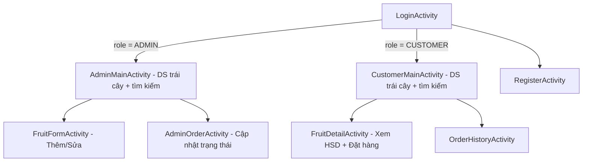

# KẾ HOẠCH DỰ ÁN — FRUIT SHOP MANAGEMENT

> Bám theo [SPEC.md](SPEC.md). Mục tiêu: **xong nhanh nhất có thể** (điểm tính theo thời gian, mục 9) mà vẫn đủ 8 yêu cầu chức năng.
> Chiến lược: **TV1 dựng nền (data layer + stub màn hình) trong ~45 phút đầu**, sau đó 3 người làm song song trên 3 nhánh, mỗi người sở hữu file riêng → gần như không conflict.

---

## 1. Công nghệ & cấu hình

| Hạng mục | Lựa chọn | Ghi chú |
|---|---|---|
| IDE | Android Studio (bản mới nhất) | Template **Empty Views Activity**, Build config language: **Kotlin DSL** |
| Ngôn ngữ | **Kotlin** | |
| UI | XML layouts + **ViewBinding** + Material Components + RecyclerView | ViewBinding thay `findViewById`, viết nhanh hơn |
| CSDL | **SQLite thuần** (`SQLiteOpenHelper`, `ContentValues`, `Cursor`) | Mục 3 của đề — không dùng Room |
| Phiên đăng nhập | `SharedPreferences` | Mục 2 của đề |
| minSdk / targetSdk | 24 / 34+ | |
| Package | `com.example.fruitshop` | |
| VCS | GitHub (repo private, thêm 2 thành viên làm collaborator) | Mục 8 của đề |

**`app/build.gradle.kts`**

```kotlin
android {
    buildFeatures { viewBinding = true }
}

dependencies {
    implementation("com.google.android.material:material:1.12.0")
    implementation("androidx.recyclerview:recyclerview:1.3.2")
    // SQLite có sẵn trong Android SDK (android.database.sqlite) — không cần thêm thư viện
}
```

> [!NOTE]
> Để tiết kiệm thời gian, gọi DAO trực tiếp trên main thread (dữ liệu nhỏ, SQLite không chặn như Room). Nếu giảng viên yêu cầu, chuyển sang `lifecycleScope.launch(Dispatchers.IO)` ở cuối dự án.

---

## 2. Kiến trúc & cấu trúc thư mục

```
app/src/main/java/com/example/fruitshop/
├── data/
│   ├── model/       Account.kt, Fruit.kt, Customer.kt, Order.kt   (data class)
│   ├── dao/         AccountDao.kt, FruitDao.kt, CustomerDao.kt, OrderDao.kt
│   └── DatabaseHelper.kt         (SQLiteOpenHelper singleton: CREATE TABLE + seed)
├── util/
│   ├── Constants.kt              (object: ROLE_ADMIN, ROLE_CUSTOMER, STATUS_*)
│   ├── HashUtil.kt               (SHA-256)
│   ├── DateUtil.kt               (today(), now(), isExpired(), isExpiringSoon())
│   └── SessionManager.kt         (SharedPreferences: session + remember me)
└── ui/
    ├── auth/        LoginActivity (launcher), RegisterActivity
    ├── admin/       AdminMainActivity, FruitFormActivity, AdminFruitAdapter,
    │                AdminOrderActivity, AdminOrderAdapter
    └── customer/    CustomerMainActivity, CustomerFruitAdapter,
                     FruitDetailActivity, OrderHistoryActivity, OrderHistoryAdapter
```

### Luồng màn hình



---

## 3. Thiết kế dữ liệu (hợp đồng chung — TV1 làm, cả nhóm dùng)

### 3.1 Schema SQLite (`DatabaseHelper.onCreate`)

```sql
CREATE TABLE Account (
    id       INTEGER PRIMARY KEY AUTOINCREMENT,
    username TEXT NOT NULL UNIQUE,
    password TEXT NOT NULL,            -- SHA-256 hex
    role     TEXT NOT NULL             -- 'ADMIN' | 'CUSTOMER'
);

CREATE TABLE Fruit (
    id          INTEGER PRIMARY KEY AUTOINCREMENT,
    name        TEXT NOT NULL,
    category    TEXT,
    price       REAL NOT NULL,
    quantity    INTEGER NOT NULL DEFAULT 0,
    expiryDate  TEXT NOT NULL,         -- 'yyyy-MM-dd' → so sánh chuỗi đúng thứ tự
    description TEXT
);

CREATE TABLE Customer (
    id        INTEGER PRIMARY KEY AUTOINCREMENT,
    fullname  TEXT NOT NULL,
    phone     TEXT,
    email     TEXT,
    accountId INTEGER NOT NULL REFERENCES Account(id) ON DELETE CASCADE
);

CREATE TABLE Orders (                  -- 'Order' là từ khóa SQL; data class Kotlin vẫn tên Order
    id          INTEGER PRIMARY KEY AUTOINCREMENT,
    customerId  INTEGER NOT NULL REFERENCES Customer(id),
    orderDate   TEXT NOT NULL,         -- 'yyyy-MM-dd HH:mm'
    totalAmount REAL NOT NULL,
    status      TEXT NOT NULL DEFAULT 'Pending'
);
```

- `onConfigure(db)`: `db.setForeignKeyConstraintsEnabled(true)`.
- `onUpgrade`: `DROP TABLE IF EXISTS` cả 4 bảng rồi gọi lại `onCreate` (đủ dùng cho bài test).
- Hằng số tên bảng/cột đặt trong `DatabaseHelper.companion object` để tránh gõ sai.

### 3.2 Model (data class)

```kotlin
data class Account(val id: Int = 0, val username: String, val password: String, val role: String)
data class Fruit(val id: Int = 0, val name: String, val category: String, val price: Double,
                 val quantity: Int, val expiryDate: String, val description: String)
data class Customer(val id: Int = 0, val fullname: String, val phone: String,
                    val email: String, val accountId: Int)
data class Order(val id: Int = 0, val customerId: Int, val orderDate: String,
                 val totalAmount: Double, val status: String)
```

### 3.3 DAO contract (chốt chữ ký trước để làm song song)

Mỗi DAO là `class XxxDao(context: Context)`, lấy `DatabaseHelper.getInstance(context)`; đọc bằng `rawQuery(sql, arrayOf(...))` + `cursor.use { }`, ghi bằng `ContentValues`.

```kotlin
// AccountDao
fun insert(a: Account): Long                         // -1 nếu trùng username
fun findByUsername(username: String): Account?
fun login(username: String, passwordHash: String): Account?

// CustomerDao
fun insert(c: Customer): Long
fun findByAccountId(accountId: Int): Customer?

// FruitDao
fun insert(f: Fruit): Long
fun update(f: Fruit): Int
fun delete(id: Int): Int
fun getById(id: Int): Fruit?
fun getAll(): List<Fruit>                            // admin
fun search(keyword: String): List<Fruit>             // admin: name/category LIKE ?
fun getAvailable(): List<Fruit>                      // customer: quantity > 0
fun searchAvailable(keyword: String): List<Fruit>

// OrderDao
fun getAll(): List<Order>                            // admin, ORDER BY id DESC
fun getByCustomer(customerId: Int): List<Order>      // lịch sử đơn
fun updateStatus(id: Int, newStatus: String, oldStatus: String): Int
//  -> db.update("Orders", cv, "id=? AND status=?", ...) — chỉ đi tiến
fun placeOrder(customerId: Int, fruitId: Int, qty: Int): Long
//  -> ném IllegalStateException("EXPIRED" | "OUT_OF_STOCK" | "INVALID_QTY")
```

**`placeOrder` dùng transaction SQLite:**

```kotlin
fun placeOrder(customerId: Int, fruitId: Int, qty: Int): Long {
    if (qty <= 0) throw IllegalStateException("INVALID_QTY")
    val db = helper.writableDatabase
    db.beginTransaction()
    try {
        val fruit = fruitDao.getById(fruitId) ?: throw IllegalStateException("NOT_FOUND")
        if (fruit.expiryDate < DateUtil.today()) throw IllegalStateException("EXPIRED")
        if (fruit.quantity < qty) throw IllegalStateException("OUT_OF_STOCK")
        db.execSQL("UPDATE Fruit SET quantity = quantity - ? WHERE id = ?", arrayOf(qty, fruitId))
        val id = db.insert("Orders", null, ContentValues().apply {
            put("customerId", customerId)
            put("orderDate", DateUtil.now())
            put("totalAmount", fruit.price * qty)
            put("status", Constants.STATUS_PENDING)
        })
        db.setTransactionSuccessful()
        return id
    } finally {
        db.endTransaction()
    }
}
```

### 3.4 Dữ liệu seed (cuối `DatabaseHelper.onCreate`)

| Loại | Dữ liệu |
|---|---|
| Admin | `admin` / `admin123` |
| Customer | `customer` / `123456` + 1 dòng Customer liên kết |
| Fruit | ≥ 6 loại: 3 còn hạn bình thường, 1 **sắp hết hạn** (≤ 3 ngày), 1 **đã hết hạn**, 1 **hết hàng** (quantity = 0) — ngày tính tương đối theo `today` để demo lúc nào cũng đúng |

### 3.5 Quy tắc nghiệp vụ (theo SPEC)

- `isExpired`: `expiryDate < today` (đúng ngày hết hạn vẫn bán được).
- `isExpiringSoon`: `today ≤ expiryDate ≤ today + 3 ngày`.
- Đặt hàng: chặn **2 lớp** — UI (disable nút/validate) **và** `OrderDao.placeOrder`.
- Trạng thái: `Pending → Confirmed → Completed`, chỉ đi tiến (Admin chỉ thấy nút chuyển sang trạng thái kế tiếp).
- Customer thấy các trái cây `quantity > 0`; trái hết hạn vẫn hiển thị với badge đỏ **"Expired"** và **không đặt được**.

---

## 4. Phân công 3 thành viên

### 👤 TV1 — Leader · Nền tảng + Admin Form & Đơn hàng (Yêu cầu 3, 4, 7-phía admin, 8)

| # | Công việc | File sở hữu |
|---|---|---|
| 1.1 | Tạo project Android Studio (Kotlin), bật ViewBinding, tạo repo GitHub, mời thành viên, `.gitignore`, README | `build.gradle.kts`, `libs.versions.toml`, `README.md` |
| 1.2 | `DatabaseHelper`: schema mục 3.1 + seed mục 3.4 | `data/DatabaseHelper.kt` |
| 1.3 | 4 data class + 4 DAO theo contract mục 3.3 (**bao gồm cả `placeOrder`, `updateStatus`**) | `data/model/**`, `data/dao/**` |
| 1.4 | `Constants`, `HashUtil`, `DateUtil`, `SessionManager` (TV2 dùng cho login — chốt API bên dưới) | `util/**` |
| 1.5 | **Tạo stub rỗng cho TẤT CẢ Activity** + đăng ký sẵn trong `AndroidManifest.xml` | `AndroidManifest.xml` |
| 1.6 | `FruitFormActivity` (dùng chung Thêm/Sửa qua extra `fruitId`): nhập 6 trường, **DatePickerDialog** cho HSD, validate (tên không rỗng, giá > 0, SL ≥ 0), lưu xong `finish()` | `ui/admin/FruitFormActivity.kt`, `activity_fruit_form.xml` |
| 1.7 | `AdminOrderActivity` + `AdminOrderAdapter`: danh sách tất cả đơn (mã, khách, ngày, tổng, trạng thái), nút chuyển trạng thái kế tiếp (Pending→Confirmed→Completed), ẩn nút khi Completed | `AdminOrderActivity.kt`, `AdminOrderAdapter.kt`, layout tương ứng, `res/values/colors_order.xml` |
| 1.8 | Review & merge PR, test tích hợp, hỗ trợ người chậm | — |

`SessionManager` cần có: `saveSession(id, username, role, customerId)`, `isLoggedIn()`, `getRole()`, `getCustomerId()`, `saveRemember(username, password)`, `clearRemember()`, `getRememberUser()/getRememberPass()`, `logout()`.

### 👤 TV2 — Đăng nhập + Admin quản lý trái cây (Yêu cầu 1, 2, 4, 5)

| # | Công việc | File sở hữu |
|---|---|---|
| 2.1 | `LoginActivity` (launcher): validate, hash mật khẩu bằng `HashUtil`, check `AccountDao.login`, lưu session, điều hướng theo role; checkbox **Remember me**, tự điền + tự đăng nhập khi mở app | `ui/auth/LoginActivity.kt`, `activity_login.xml` |
| 2.2 | `RegisterActivity`: tạo Account (CUSTOMER) + Customer, check trùng username, đăng ký xong quay về Login | `ui/auth/RegisterActivity.kt`, `activity_register.xml` |
| 2.3 | Logout: hàm dùng chung (VD `fun Activity.logout()` trong `ui/auth/AuthExt.kt`) gọi `SessionManager.logout()` + về Login, xóa back stack — TV3 và màn Admin gọi lại | `ui/auth/AuthExt.kt` |
| 2.4 | `AdminMainActivity`: RecyclerView danh sách trái cây, ô tìm kiếm (theo tên/loại, lọc realtime bằng `doAfterTextChanged`), FAB "Thêm" → mở `FruitFormActivity`, reload ở `onResume`, menu: *Quản lý đơn hàng*, *Đăng xuất* | `ui/admin/AdminMainActivity.kt`, `activity_admin_main.xml` |
| 2.5 | `AdminFruitAdapter` + `item_fruit_admin.xml`: tên, loại, giá, SL, HSD, **badge Expired / Expiring soon**; nút Sửa (mở form kèm `fruitId`) / Xóa (dialog xác nhận) | `AdminFruitAdapter.kt`, `item_fruit_admin.xml`, `res/values/colors_admin.xml` |

### 👤 TV3 — Chức năng Customer (Yêu cầu 5, 6, 7-phía customer)

| # | Công việc | File sở hữu |
|---|---|---|
| 3.1 | `CustomerMainActivity`: danh sách trái cây có hàng, tìm kiếm, menu: *Lịch sử đơn*, *Đăng xuất* | `ui/customer/CustomerMainActivity.kt`, `activity_customer_main.xml` |
| 3.2 | `CustomerFruitAdapter` + `item_fruit_customer.xml`: tên, giá, HSD, badge Expired (đỏ) / Expiring soon (cam); item hết hạn làm mờ | `CustomerFruitAdapter.kt`, `item_fruit_customer.xml` |
| 3.3 | `FruitDetailActivity`: đầy đủ thông tin + HSD, ô nhập số lượng, hiển thị tổng tiền realtime, nút **Đặt hàng** (disable nếu hết hạn / SL không hợp lệ), gọi `placeOrder`, bắt `IllegalStateException` → Toast lỗi | `FruitDetailActivity.kt`, `activity_fruit_detail.xml` |
| 3.4 | `OrderHistoryActivity` + adapter: đơn của customer đang đăng nhập (mã, ngày, tổng tiền, trạng thái có màu) | `OrderHistoryActivity.kt`, `OrderHistoryAdapter.kt`, layout tương ứng |
| 3.5 | Định dạng tiền tệ (VD `NumberFormat.getCurrencyInstance(Locale("vi", "VN"))`) | `res/values/colors_customer.xml` |

> [!IMPORTANT]
> **Quy tắc tránh conflict:** chỉ sửa file mình sở hữu. `FruitFormActivity` (TV1) và `AdminMainActivity` (TV2) giao tiếp chỉ qua Intent extra `"fruitId"` (không truyền = Thêm mới). Cần sửa `AndroidManifest.xml`, `strings.xml`, `data/**`, `util/**` → nhắn TV1 sửa hoặc mở PR nhỏ riêng. Mỗi người dùng file `colors_*.xml` / chuỗi hard-code riêng thay vì cùng sửa `colors.xml`/`strings.xml`.

---

## 5. Timeline (mục tiêu ~3–3.5 giờ)

```mermaid
gantt
    dateFormat HH:mm
    axisFormat %H:%M
    section TV1
    Setup repo + SQLite + DAO + Stub     :t1a, 00:00, 50m
    FruitFormActivity (Thêm/Sửa)         :t1b, after t1a, 40m
    Admin quản lý đơn hàng               :t1c, after t1b, 35m
    Review PR + tích hợp + test          :t1d, after t1c, 55m
    section TV2
    Vẽ layout login/register/admin       :t2a, 00:00, 50m
    Login + Remember me + Register       :t2b, after t2a, 55m
    Admin DS trái cây + Search + Xóa     :t2c, after t2b, 45m
    Fix bug                              :t2d, after t2c, 30m
    section TV3
    Vẽ layout XML customer (chưa cần DB) :t3a, 00:00, 50m
    Danh sách + Search + Chi tiết        :t3b, after t3a, 60m
    Đặt hàng + Lịch sử đơn               :t3c, after t3b, 50m
    Fix bug                              :t3d, after t3c, 20m
```



| Giai đoạn | Thời gian | Nội dung | Điều kiện hoàn thành |
|---|---|---|---|
| **P0 – Nền tảng** | 0:00 – 0:50 | TV1: mục 1.1 → 1.5, push thẳng `main`. TV2/TV3: clone, vẽ layout XML trên nhánh riêng | App build được, DB tạo + seed thành công (kiểm tra bằng **App Inspection → Database Inspector**), mọi Activity stub mở được |
| **P1 – Tính năng** | 0:50 – 2:30 | Ba người làm song song; TV2/TV3 `git pull origin main` rồi rebase nhánh của mình | Mỗi nhánh tự chạy đúng phần mình |
| **P2 – Tích hợp** | 2:30 – 3:00 | Merge PR theo thứ tự: `feature/auth` → `feature/admin-fruit` → `feature/admin-order` → `feature/customer`; chạy checklist mục 7 | Checklist pass 100% |
| **P3 – Hoàn thiện** | 3:00 – 3:20 | Fix bug, README (tài khoản demo, ảnh chụp), tag `v1.0` | Tag `v1.0` trên GitHub |

---

## 6. Quy trình Git (Yêu cầu 8)

- **Nhánh:** `main` (luôn build được) · `feature/admin-order` (TV1, gồm cả FruitForm) · `feature/auth` + `feature/admin-fruit` (TV2) · `feature/customer` (TV3).
- TV2 làm `feature/auth` trước → mở PR merge sớm (~1:45) để TV3 test luồng đăng nhập thật, rồi tạo `feature/admin-fruit` từ `main` mới.
- **Commit:** nhỏ, thường xuyên, theo mẫu `feat: ...`, `fix: ...`, `ui: ...`, `chore: ...` (VD `feat(admin): add fruit search`).
- **Pull Request:** mỗi tính năng 1 PR → 1 người khác review nhanh → **Squash/Merge**. TV1 là người merge cuối.
- **Đồng bộ:** trước khi push: `git pull --rebase origin main`.
- **`.gitignore`:** dùng mẫu Android (`/build`, `.gradle`, `local.properties`, `.idea/` trừ code style, `*.apk`).
- Ai cũng phải có commit trên repo (thể hiện làm việc nhóm).

---

## 7. Checklist nghiệm thu (map với đề)

| Đề | Test case | Người test |
|---|---|---|
| 1. Login | Đăng nhập admin → màn Admin; customer → màn Customer; sai mật khẩu → báo lỗi; đăng ký tài khoản mới đăng nhập được | TV1 (test chéo) |
| 2. SharedPreferences | Tick Remember me → thoát app mở lại tự đăng nhập; Logout → về Login; bỏ tick → không tự điền | TV1 (test chéo) |
| 3. SQLite | Thêm dữ liệu → tắt hẳn app → mở lại dữ liệu vẫn còn; mở Database Inspector thấy đủ 4 bảng, cột `password` là chuỗi SHA-256 | TV1 |
| 4. Admin CRUD | Thêm / sửa / xóa / tìm theo tên & loại / xem đủ 6 trường | TV3 (test chéo) |
| 5. Expiry | Badge Expired & Expiring soon đúng; trái hết hạn **không đặt được** (UI + DAO) | TV2 + TV3 |
| 6. Customer | Xem DS, tìm kiếm, xem HSD, đặt hàng, xem lịch sử | TV2 (test chéo) |
| 7. Order | Đặt quá tồn kho → lỗi; đặt thành công → kho giảm, đơn `Pending`; Admin chuyển Confirmed → Completed, không lùi được | TV2 + TV3 (test chéo) |
| 8. Git | Đủ 3 người có commit, có PR, có nhánh feature | TV1 |

---

## 8. Rủi ro & phương án

| Rủi ro | Phương án |
|---|---|
| Quên đóng `Cursor` → rò rỉ / crash | Luôn dùng `cursor.use { }`; `DatabaseHelper` là singleton, không gọi `db.close()` lung tung |
| SQL injection / lỗi dấu nháy khi search | Luôn truyền tham số qua `?` + `selectionArgs`, không nối chuỗi |
| Đọc sai cột (`getColumnIndex` trả -1) | Dùng `getColumnIndexOrThrow` + hằng số tên cột trong `DatabaseHelper` |
| Conflict `AndroidManifest.xml` | TV1 đăng ký sẵn mọi Activity ở P0 |
| Đổi schema giữa chừng | Tăng `DB_VERSION` (onUpgrade drop + tạo lại) hoặc gỡ app/xóa data khi test |
| Lệch múi giờ / định dạng ngày | Chỉ dùng `DateUtil` (format `yyyy-MM-dd`, `Locale.US`) cho mọi chỗ |
| Một người bị chậm | TV1 sau P1 hỗ trợ trực tiếp phần đang chậm (thường là Order) |
